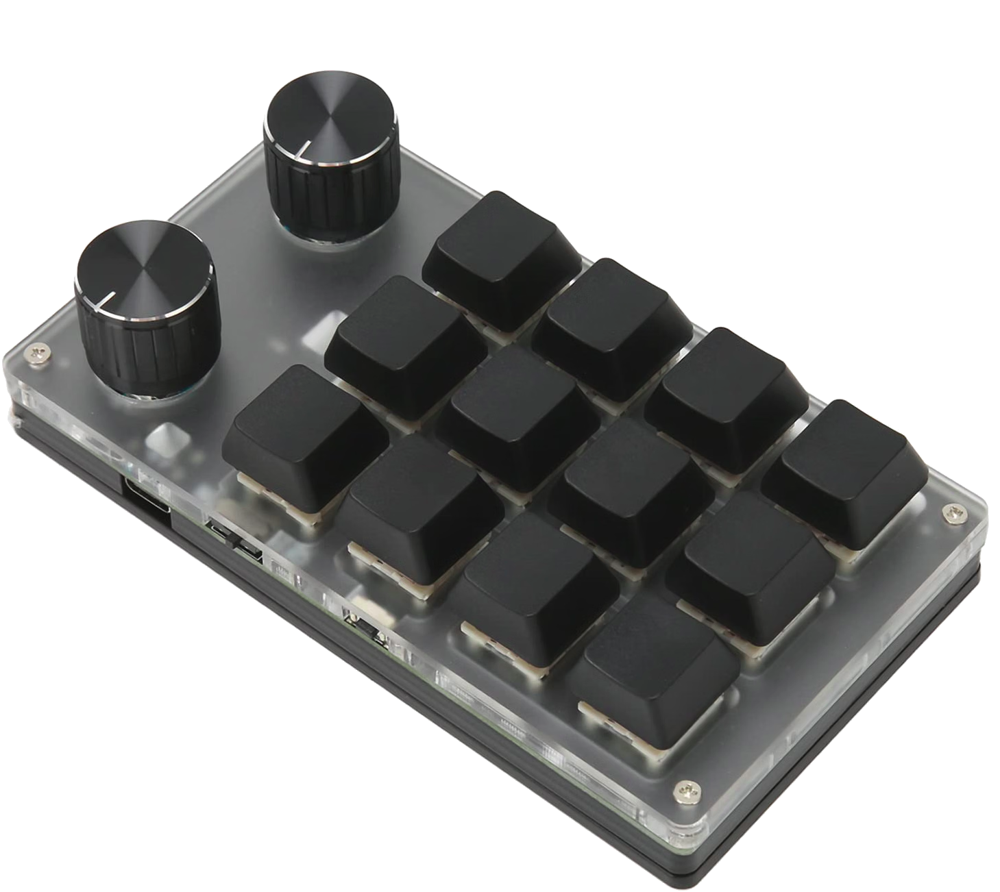

# Patchbay

**Route your macro keypad to any application.**

Patchbay is a desktop app for programming cheap WCH CH57x macro keypads (12 keys, 2 clickable rotary encoders, 3 onboard layers) with per-application profiles. Pick a key, pick an action — Patchbay handles the firmware and the Linux input plumbing for you.



*Product photo from the vendor listing; this is the exact device Patchbay is developed against.*

## Why

Keypads like this are sold with clunky web configurators and no way to organize controls around the software you actually use. Patchbay treats the pad as a patch panel: physical controls on one side, application actions on the other, and a clean editor in between.

The original use case is [KiCad](https://www.kicad.org) PCB and schematic editing — routing tools, track widths, layer switching, and encoder-driven zoom under your fingers — but Patchbay is application-agnostic by design.

## How it works

```text
physical key / encoder (onboard layer)
  -> firmware mapping (YAML, uploaded over USB via ch57x-keyboard-tool)
  -> Patchbay daemon (grabs the device with evdev, resolves profile + action)
  -> output: injected key chord (uinput) · launched program · script · native action
```

- **One daemon, one config.** No remapper presets per transport, no origin hashes, no autoload fragility. The daemon reads the keypad directly and produces output through a virtual keyboard or by executing actions natively.
- **Layer awareness.** The firmware assigns a unique surrogate code per control per layer, so the daemon always knows which control on which layer you pressed — no hardware read-back required.
- **Profiles, per application.** An application manifest (window match rules + action list) contains multiple profiles; each profile maps all three layers of the pad. The active profile follows the focused window, or you pin it manually.
- **Action types are pluggable.** `chord` (inject keys), `exec` (launch programs / scripts), and `native` (app-specific integrations) are small executor plugins. Adding a capability is one module; adding an application or profile is just data.
- **Honest state tracking.** Saved, uploaded, and physically-tested are distinct states. A successful save is never presented as proof the hardware was programmed.

## Hardware

| | |
|---|---|
| Chip | WCH CH57x |
| USB ID | `1189:8890` |
| Bluetooth | generic `HID Keyboard` |
| Controls | 12 keys (3×4), 2 clickable encoders, side layer button |
| Layers | 3 onboard, cycled by the side button (LED indicators) |
| Programming | USB, via [ch57x-keyboard-tool](https://github.com/joekid/ch57x-keyboard-tool) (validate + upload; no read-back) |

Control layout and numbering used throughout Patchbay profiles:


## Project layout

```text
patchbay/
  daemon/      input grabber, profile engine, action executors
  gui/         PySide6 profile editor (visual pad, layer tabs, action picker)
  manifests/   application definitions (data)
  profiles/    user profiles (data)
  firmware/    generated CH57x YAML profiles + upload helpers
```

## Status

Early development. The KiCad workflow this replaces (firmware YAML + input-remapper presets, hand-maintained) works today; Patchbay's goal is to make that setup editable, portable, and robust.

Roadmap:

- [ ] Daemon core: evdev grab → surrogate decode → uinput chord injection
- [ ] GUI editor: visual pad layout, layer tabs, searchable action picker
- [ ] KiCad manifest generated from KiCad's own hotkey action list
- [ ] Firmware generation + one-click validate/upload
- [ ] General-purpose mode: launchers, scripts, system actions
- [ ] Active-window profile switching
- [ ] Import from existing input-remapper setups

## License

MIT — see [LICENSE](LICENSE).
